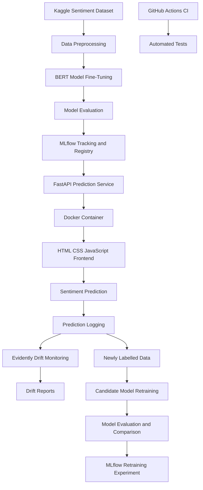

# Sentiment Analysis MLOps Pipeline

An end-to-end MLOps project for three-class sentiment analysis using a fine-tuned BERT model. The project integrates data preprocessing, model training, experiment tracking, model serving, Docker containerization, data drift monitoring, candidate model retraining, and continuous integration.

---

## 1. Project Overview

The objective of this project is to develop an intelligent sentiment analysis system that classifies textual data into three categories:

- Positive
- Negative
- Neutral

The project demonstrates the major stages of the Machine Learning Operations (MLOps) lifecycle, from dataset preparation and model development to API serving, monitoring, retraining, and automated testing.

## 2. Technology Stack

| Component | Technology |
|---|---|
| Programming Language | Python |
| Dataset | Kaggle Sentiment Analysis Dataset |
| NLP Model | BERT (`bert-base-uncased`) |
| Deep Learning Framework | Hugging Face Transformers |
| Experiment Tracking | MLflow |
| Backend API | FastAPI |
| Frontend | HTML, CSS, JavaScript |
| Containerization | Docker |
| Drift Monitoring | Evidently AI |
| Continuous Integration | GitHub Actions |
| Version Control | Git and GitHub |

## 3. System Architecture

The following diagram represents the implemented project workflow.



## 4. Dataset Collection and Preprocessing

The project uses a Kaggle Sentiment Analysis Dataset.

### Dataset details

- Original records: 3,534
- Records after duplicate removal: 3,533
- Classification categories: Positive, Negative, Neutral

### Preprocessing

The preprocessing stage prepares raw textual data for model training by cleaning the dataset and removing duplicate records.

The processed dataset is stored in:

`data/processed/kaggle_sentiment_clean.csv`

## 5. BERT Model Development

We used the pretrained `bert-base-uncased` transformer model and fine-tuned it for three-class sentiment classification.

### Training configuration

| Parameter | Value |
|---|---:|
| Model | bert-base-uncased |
| Maximum sequence length | 64 |
| Batch size | 8 |
| Learning rate | 2e-5 |
| Maximum training steps | 300 |
| Training samples | 2,826 |
| Validation samples | 353 |
| Test samples | 354 |

### Model evaluation

| Metric | Result |
|---|---:|
| Test Accuracy | 71.19% |
| Test F1-score | 71.05% |

The trained model is saved in:

`models/bert_sentiment_kaggle`

## 6. MLflow Experiment Tracking and Model Registry

MLflow is used to track machine learning experiments, record evaluation metrics, store artifacts, and manage model versions.

### Experiments created

| Experiment | Purpose |
|---|---|
| `sentiment-analysis-bert` | Original BERT model training |
| `sentiment-analysis-monitoring` | Data drift monitoring results |
| `sentiment-analysis-retraining` | Baseline and candidate model comparison |

### Model registration

Registered model:

`sentiment-bert-kaggle`

Version: `1`

Model registration provides a way to maintain model versions and associate models with their source runs.

## 7. FastAPI Prediction Service

FastAPI provides a REST API that allows external applications to communicate with the trained sentiment classification model.

### Available endpoints

| Method | Endpoint | Description |
|---|---|---|
| GET | `/health` | Checks API and model availability |
| POST | `/predict` | Predicts sentiment for submitted text |

### Example request

```json
{
  "text": "I absolutely love this product!"
}
```

### Example response

```json
{
  "text": "I absolutely love this product!",
  "sentiment": "positive",
  "confidence": 0.8796
}
```

Prediction records are stored in:

`monitoring/predictions.csv`

### API documentation

The interactive Swagger documentation is available locally at:

`http://127.0.0.1:8000/docs`

## 8. Frontend Development

A simple web interface was developed using:

- HTML for webpage structure.
- CSS for styling.
- JavaScript for API communication.

### Frontend functionality

1. Accepts text input from users.
2. Sends the text to the FastAPI `/predict` endpoint.
3. Receives the model prediction.
4. Displays the predicted sentiment and confidence score.

The frontend is stored in:

`frontend/index.html`

It was tested locally using:

`http://127.0.0.1:5500`

## 9. Docker Containerization

Docker was used to package the FastAPI application and its dependencies into a container.

### Docker details

| Component | Value |
|---|---|
| Image | `sentiment-api:kaggle` |
| Container | `sentiment-api-kaggle` |
| Port | `8000` |

The container was successfully tested locally.

Docker provides a consistent environment for running the prediction service.

**Note:** Cloud deployment has not yet been implemented.

## 10. Data Drift Monitoring Using Evidently AI

Evidently AI is used to compare incoming prediction text data against reference data to identify changes in data distribution.

### Monitoring configuration

- Reference dataset: Sample of original dataset.
- Current dataset: Production prediction records.
- Reference samples: 1,000.
- Production samples: 39.

### Observed monitoring results

| Metric | Result |
|---|---:|
| Text drift score | 0.8357 |
| Drifted columns | 1 |
| Drift share | 1.0 |
| Drift detected | True |

The monitoring workflow generates:

- `monitoring/drift_report.html`
- `monitoring/evidently_results.json`

These monitoring results are also logged to MLflow.

**Note:** Data drift indicates a change in incoming data distribution. It does not independently establish a decline in model accuracy.

## 11. Candidate Model Retraining

A separate retraining workflow was implemented using newly labelled examples.

### Retraining dataset

File:

`monitoring/retraining_data.csv`

- Total labelled examples: 30
- Training samples: 24
- Testing samples: 6

### Baseline and candidate comparison

| Metric | Original Model | Candidate Model |
|---|---:|---:|
| Accuracy | 83.33% | 100% |
| Macro F1-score | 82.22% | 100% |

The candidate model is saved separately in:

`models/bert_sentiment_kaggle_candidate`

### Controlled retraining strategy

The candidate model is trained and evaluated separately from the existing production model.

The original production model is preserved during candidate evaluation.

The candidate is not automatically promoted to production.

A larger independent test dataset and further validation are required before considering model replacement.

### Rollback strategy

The current implementation preserves the original production model separately from the candidate model.

If a candidate model performs poorly during evaluation or integration testing, the existing production model remains in use.

A fully automated model promotion and rollback mechanism has not yet been implemented.

## 12. Continuous Integration Using GitHub Actions

GitHub Actions is used to automate the configured testing workflow.

Workflow file:

`.github/workflows/ci.yml`

### CI process

1. Code is pushed to the GitHub repository.
2. GitHub Actions triggers the workflow.
3. The configured test job executes.
4. The workflow reports success or failure.

### Latest CI result

- Commit: `45263e3`
- Workflow: `ci.yml`
- Job: `test`
- Status: Successful
- Duration: Approximately 1 minute 28 seconds.

The successful workflow confirms that the configured CI tests passed for the latest commit.

Continuous Deployment (CD) has not yet been implemented.

## 13. Project Directory Structure

```text
sentiment-analysis-mlops/
│
├── app/
│   └── main.py
│
├── data/
│   ├── raw/
│   │   └── kaggle_sentiment.xlsx
│   └── processed/
│       └── kaggle_sentiment_clean.csv
│
├── frontend/
│   └── index.html
│
├── models/
│   ├── bert_sentiment_kaggle/
│   └── bert_sentiment_kaggle_candidate/
│
├── monitoring/
│   ├── drift_report.py
│   ├── predictions.csv
│   ├── retraining_data.csv
│   ├── drift_report.html
│   └── evidently_results.json
│
├── src/
│   ├── preprocess.py
│   └── retrain.py
│
├── tests/
│
├── .github/
│   └── workflows/
│       └── ci.yml
│
├── Dockerfile
├── .gitignore
└── README.md
```

## 14. Running the Project Locally

### Step 1: Clone the repository

```bash
git clone https://github.com/pavani80179/sentiment-analysis-mlops.git
cd sentiment-analysis-mlops
```

### Step 2: Create and activate a virtual environment

```powershell
python -m venv .venv
.venv\Scripts\activate
```

### Step 3: Install project dependencies

Install the packages specified in the project's dependency file, if available.

### Step 4: Run the FastAPI service

```bash
uvicorn app.main:app --host 0.0.0.0 --port 8000
```

### Step 5: Open API documentation

`http://127.0.0.1:8000/docs`

### Step 6: Run the frontend

Open another terminal:

```powershell
cd frontend
python -m http.server 5500
```

Open:

`http://127.0.0.1:5500`

### Step 7: Run Docker

Start Docker Desktop and run the existing Docker container:

```bash
docker start sentiment-api-kaggle
```

Check the container:

```bash
docker ps
```

## 15. Current Limitations and Future Enhancements

The following features are planned for future development:

- DVC integration for dataset and pipeline versioning.
- Cloud deployment of the API and frontend.
- Continuous monitoring of production prediction distribution.
- Production model performance evaluation using newly labelled data.
- Automated candidate model promotion.
- Automated model rollback.
- Continuous Deployment (CD) integration.
- Larger labelled datasets for reliable retraining evaluation.

## 16. Conclusion

This project demonstrates an end-to-end MLOps workflow for sentiment analysis using a fine-tuned BERT model.

It integrates data preprocessing, model development, experiment tracking, model registration, REST API development, Docker containerization, data drift monitoring, candidate model retraining, and automated CI testing.

The implementation demonstrates how machine learning models can be developed, served, monitored, and evaluated as part of a practical MLOps pipeline.
